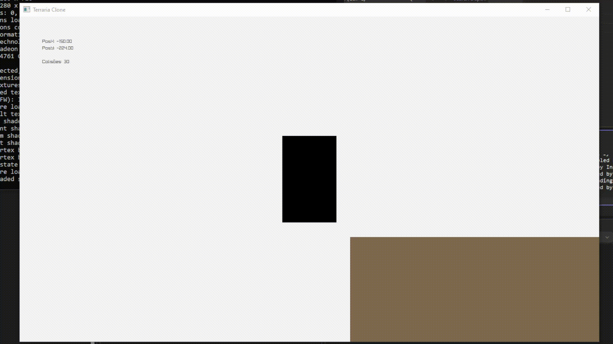

# Terraria_Raylib

## Descrição:

Este projeto consiste no desenvolvimento de um jogo inspirado em Terraria utilizando C++ e a biblioteca Raylib, incorporando recursos autorais (como assets, músicas e efeitos sonoros). O objetivo central é estudar desenvolvimento de jogos desde fundamentos até técnicas mais avançadas.

## Dia 003: Câmera adicionada, iniciada lógica de Hitbox por aproximação, tileGrid em testes, organização geral do código.

## Lista:

✅ GameLoop, taxa fixa (60FPS, 120UPS);

✅ Input/Movimentação do jogador;

✅ Renderizar um tile, adicionar hitbox;

✅ TileGrid (array de tiles que representa o mapa);

✅ Câmera;

⏳ Hitbox por aproximação;

⏳ Sprites e mais tiles;

⏳ Ler informações dos tiles de um TXT;

⏳ Atualização do input;

## Próximo passo:

Vou implementar um calculo dinâmico para a hitbox dos tiles, apenas para os tiles mais próximos do jogador otimizando o código. Também irei atualizar o input substituindo os condicionais.

## Referência:

Utilizei um molde de projeto onde o Raylib já estava vinculado ao Cmake para ser buildado junto ao jogo. Este modelo foi distribuído de forma gratuita pelo dono do canal LowLevelGameDev: https://www.youtube.com/@lowlevelgamedev9330/featured).

Caso tenha interesse em utilizar este ou outros modelos, sinta-se a vontade para acessar o seguinte video: https://www.youtube.com/watch?v=FrVABOhRyQg&t.

## Pré-requisitos:

    Linguagem / Padrão: C++ (compatível com CMake).

    Build System: CMake.

    IDE: Visual Studio (ou outro ambiente compatível com CMake e C++).

    Biblioteca: Raylib.

## Instalação/Uso:

### Clone este repositório em sua máquina local:
    
    git clone https://github.com/seu-usuario/Terraria_Raylib.git

### Certifique-se de que a Raylib e o CMake estão instalados e acessíveis no seu ambiente.

### Abra a pasta do projeto no Visual Studio (com suporte a projetos CMake) ou gere os arquivos de solução/build via CMake:
    
    cmake -B build
    cmake --build build

### Comandos

  - Movimento do jogador: SETAS (Cima, Baixo, Direita, Esquerda)

## Tecnologias:

    C++;
    Raylib;
    CMake;
    Visual Studio.

Licença:
MIT License
